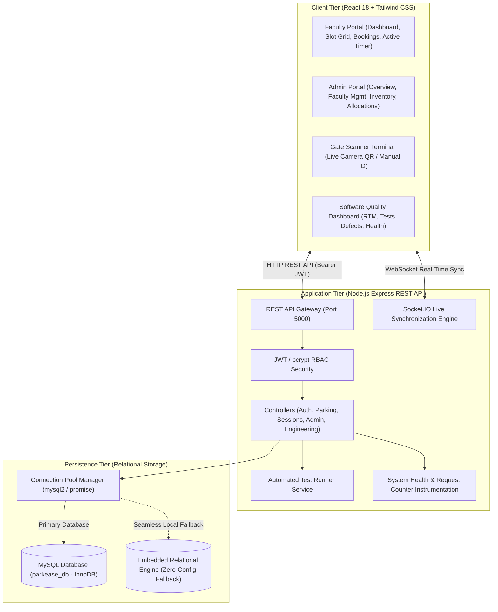

# ParkEase – Smart Parking Management System

> **College Mini Project for Software Engineering and Architecture (SEA)**  
> **Specification Version:** SRS v1.0 • **Type:** 100% Software-Based Application

ParkEase is a centralized, full-stack smart parking management web application engineered specifically for college faculty members and campus administrators. The system streamlines campus parking slot discovery, reservation, digital QR gate pass generation, entry/exit verification, real-time availability synchronization, utilization reporting, and software quality management.

> [!IMPORTANT]
> **100% SOFTWARE-BASED ARCHITECTURE:**  
> This project is completely software-driven. All parking availability, occupancy updates, and entry/exit verifications are handled through the web application, digital QR codes, and database transactions without requiring physical IoT sensors, microcontrollers (Arduino/ESP32), or external hardware cameras.

---

## 1. Key Features

### Faculty Portal
- **Secure Authentication:** Registration with faculty ID, department, contact, and vehicle details. Secure login with bcrypt password hashing and JWT token issuance.
- **Visual Parking Availability Grid:** Real-time color-coded slot grid:
  - 🟢 **Available (Green)** – Ready for reservation.
  - 🔴 **Occupied (Red)** – Vehicle currently parked in campus bay.
  - 🔵 **Reserved (Blue)** – Booked / allocated for upcoming window.
  - ⚪ **Unavailable (Grey)** – Maintenance / offline.
- **Slot Reservation & Concurrency Control:** Interactive date and time slot booking with atomic concurrency double-booking prevention.
- **Digital QR Gate Passes:** Automatically generates a verifiable QR code encoding unique booking ID (`PE-YYYYMMDD-XXXX`) for campus gate entry and exit.
- **Active Session Dashboard:** Live parking duration timer showing elapsed hours, minutes, and seconds while vehicle is inside the facility.
- **My Bookings & History:** View confirmed passes, print/download passes, cancel bookings, and inspect chronological parking history.
- **In-App Notifications:** Real-time push alerts for booking confirmation, gate entry, departure, and cancellation.
- **Profile & Vehicle Management:** Manage department contact details and registered vehicles (Cars, Motorcycles, EVs).

### Administrator Portal
- **Live Operations Dashboard:** Metric cards for total slots, available, occupied, reserved, active sessions, and college utilization percentage.
- **Entry & Exit Gate Terminal:** Browser camera QR code scanner with manual Booking ID fallback input for gate operators.
- **Faculty Account Management:** Search, filter, view parking history, and activate/deactivate faculty access.
- **Parking Area & Slot Management:** Create campus parking zones (e.g. Main Academic Block, Tech Annex, Executive Wing) and add, edit, or safely delete slots.
- **Direct Administrative Allocations:** Assign reserved bays to faculty members with automatic scheduling collision checks.
- **Manual Occupancy Override:** Rapidly toggle slot status for on-the-spot adjustments.
- **Reports & Analytics (Recharts):** Interactive donut charts, weekly booking volume bars, area utilization comparison, and peak hourly heatmap curves.
- **Audit Activity Logging:** Complete forensic compliance trail tracking actor, action, target record, IP address, and timestamp.
- **Software Quality & Testing Dashboard (SEA Core):**
  - **Requirement Traceability Matrix (RTM):** Full mapping of all 32 SRS requirements (REQ-01 to REQ-32).
  - **Automated Test Management:** 20 test cases (TC-01 to TC-20) covering Unit, Integration, Functional, System, Validation, and Security testing. Includes a **one-click live test runner**!
  - **Defect & Issue Tracking:** Report, assign, prioritize (Critical/High/Medium/Low), and resolve software bugs.
  - **System Health Monitoring:** Live backend uptime, database connection state, latency in ms, total query counts, API traffic metrics, and HTTP error logs.

---

## 2. Technology Stack

| Layer | Technologies Used |
| :--- | :--- |
| **Frontend** | React 18, Tailwind CSS, React Router DOM v7, Axios, Recharts, Lucide React, HTML5-QRCode, Canvas-Confetti, Vite |
| **Backend** | Node.js (v24), Express.js REST API, Socket.IO (WebSocket Engine), JWT, bcryptjs, CORS, Dotenv |
| **Database** | MySQL (InnoDB, Foreign Keys, Indexes, 3NF Normalization) via `mysql2/promise` + Embedded Relational SQLite Fallback |
| **Testing** | Jest, Supertest, Custom Automated Test Harness |
| **Architecture** | 3-Tier Layered Architecture (Presentation, Application REST API, Relational Persistence) |

---

## 3. Demo Credentials (For Evaluation & Viva)

The system is pre-seeded with realistic faculty and administrative demo accounts:

| Role | Email Address | Password | Faculty ID / Name |
| :--- | :--- | :--- | :--- |
| **Administrator** | `admin@college.edu` | `Admin@123` | `ADM-001` • Dr. Suresh Mehta |
| **Faculty 1 (CS)** | `faculty1@college.edu` | `Faculty@123` | `FAC-CS-101` • Dr. Aarav Sharma |
| **Faculty 2 (EC)** | `faculty2@college.edu` | `Faculty@123` | `FAC-EC-102` • Prof. Priya Patel |
| **Faculty 3 (ME)** | `faculty3@college.edu` | `Faculty@123` | `FAC-ME-103` • Dr. Vikram Malhotra |
| **Faculty 4 (CV)** | `faculty4@college.edu` | `Faculty@123` | `FAC-CV-104` • Dr. Ananya Roy |
| **Faculty 5 (MG)** | `faculty5@college.edu` | `Faculty@123` | `FAC-MG-105` • Prof. Rajesh Verma |

> [!TIP]
> The Login page features **One-Click Quick Demo Buttons** for Admin and Faculty so evaluators can switch roles instantly without typing credentials!

---

## 4. System Architecture Diagram



---

## 5. Complete Folder Structure

```
SEA MINI PROJECT/
├── backend/
│   ├── src/
│   │   ├── config/
│   │   │   └── database.js          # Dual-mode DB adapter (MySQL + Embedded Relational)
│   │   ├── controllers/
│   │   │   ├── authController.js        # Registration, login, profile
│   │   │   ├── parkingController.js     # Slot discovery, atomic reservations
│   │   │   ├── sessionController.js     # QR gate entry & exit verification
│   │   │   ├── adminController.js       # Admin oversight, allocations, reports
│   │   │   ├── engineeringController.js # RTM, Test runner, Defects, Health
│   │   │   └── notificationController.js# In-app notifications
│   │   ├── middleware/
│   │   │   ├── authMiddleware.js        # JWT token verification
│   │   │   ├── roleMiddleware.js        # RBAC access control (Admin vs Faculty)
│   │   │   ├── auditLogger.js           # Audit compliance logging
│   │   │   └── requestCounter.js        # System health instrumentation
│   │   ├── routes/
│   │   │   ├── authRoutes.js
│   │   │   ├── parkingRoutes.js
│   │   │   ├── sessionRoutes.js
│   │   │   ├── adminRoutes.js
│   │   │   ├── engineeringRoutes.js
│   │   │   └── notificationRoutes.js
│   │   ├── services/
│   │   │   ├── qrService.js             # QR code data URL generation
│   │   │   └── socketService.js         # WebSocket real-time event broadcasting
│   │   ├── utils/
│   │   │   └── helpers.js               # Booking ID generator & interval algorithms
│   │   ├── app.js                       # Express app configuration & middlewares
│   │   └── server.js                    # HTTP server entrypoint
│   ├── database/
│   │   ├── schema.sql                   # MySQL DDL schema (Tables, Foreign Keys, Indexes)
│   │   ├── seed.sql                     # Raw SQL seed data for phpMyAdmin / MySQL CLI
│   │   ├── seedData.js                  # Structured JS seed objects with bcrypt hashes
│   │   └── seed.js                      # Automated database seeder script
│   ├── tests/
│   │   ├── auth.test.js                 # Authentication & Validation test suite
│   │   ├── parking.test.js              # Booking & Concurrency test suite
│   │   └── security_and_gate.test.js    # Gate verification & RBAC test suite
│   ├── .env                             # Environment configuration
│   ├── .env.example
│   └── package.json
│
├── frontend/
│   ├── src/
│   │   ├── components/
│   │   │   ├── common/
│   │   │   │   ├── Navbar.jsx           # Top navigation with live sync indicator
│   │   │   │   ├── Sidebar.jsx          # Role-based sidebar navigation
│   │   │   │   ├── StatCard.jsx         # Metric display cards
│   │   │   │   ├── Modal.jsx            # Accessible dialogue container
│   │   │   │   └── QRScannerModal.jsx   # Camera scanner + manual input fallback
│   │   │   └── parking/
│   │   │       ├── SlotCard.jsx         # Color-coded slot bay card
│   │   │       ├── ParkingSlotGrid.jsx  # Interactive slot matrix with filters
│   │   │       ├── BookingModal.jsx     # Reservation dialog with conflict check
│   │   │       └── QRCodeModal.jsx      # High-definition QR pass viewer
│   │   ├── context/
│   │   │   ├── AuthContext.jsx          # Authentication state management
│   │   │   ├── SocketContext.jsx        # Live WebSocket connection
│   │   │   └── NotificationContext.jsx  # In-app notification state
│   │   ├── pages/
│   │   │   ├── auth/
│   │   │   │   ├── Login.jsx            # Login with one-click demo buttons
│   │   │   │   └── Register.jsx         # Faculty & vehicle registration
│   │   │   ├── faculty/
│   │   │   │   ├── FacultyDashboard.jsx # Overview, active session, quick actions
│   │   │   │   ├── ParkingAvailability.jsx # Interactive campus slot matrix
│   │   │   │   ├── MyBookings.jsx       # My passes & cancellation
│   │   │   │   ├── ActiveSession.jsx    # Live parking duration timer
│   │   │   │   ├── ParkingHistory.jsx   # Completed session history
│   │   │   │   └── Profile.jsx          # Profile & vehicle details
│   │   │   ├── admin/
│   │   │   │   ├── AdminDashboard.jsx   # Operational metrics & audit stream
│   │   │   │   ├── FacultyManagement.jsx# Faculty accounts & access toggle
│   │   │   │   ├── ParkingAreas.jsx     # Campus parking areas configuration
│   │   │   │   ├── ParkingSlots.jsx     # Slot management & status overrides
│   │   │   │   ├── Allocations.jsx      # Direct administrative bay allocation
│   │   │   │   ├── EntryExitGate.jsx    # Gate controller verification terminal
│   │   │   │   ├── ReportsAnalytics.jsx # Interactive Recharts charts
│   │   │   │   ├── AuditLogs.jsx        # Compliance audit trail
│   │   │   │   └── QualityDashboard.jsx # RTM, Test Runner, Defects, Health
│   │   │   └── NotFound.jsx
│   │   ├── services/
│   │   │   └── api.js                   # Axios HTTP client with interceptors
│   │   ├── App.jsx                      # Protected routing & layout
│   │   ├── main.jsx
│   │   └── index.css                    # Tailwind CSS styles
│   ├── tailwind.config.js
│   ├── vite.config.js
│   └── package.json
│
└── docs/
    ├── ARCHITECTURE.md                  # Layered architecture & DFDs
    ├── USE_CASE_DIAGRAM.md              # Mermaid Use Case diagrams
    ├── CLASS_DIAGRAM.md                 # Mermaid Class diagram
    ├── ER_DIAGRAM.md                    # Mermaid Entity-Relationship diagram
    ├── API_DOCUMENTATION.md             # Complete REST API reference
    ├── REQUIREMENT_TRACEABILITY_MATRIX.md # REQ-01 to REQ-32 RTM
    └── SOFTWARE_TEST_PLAN.md            # Test strategy & TC-01 to TC-20 results
```

---

## 6. Installation & Execution Instructions

### Prerequisites
- **Node.js:** v18+ or v24+
- **MySQL (Optional but Recommended):** MySQL 8.0 / MariaDB / XAMPP on port 3306.  
  *(Note: ParkEase features an intelligent dual-database engine. If MySQL is not running, it automatically operates on an embedded relational store so evaluation is never blocked!)*

### Step 1: Clone or Open Workspace
Open a PowerShell terminal in the project directory:
```powershell
cd "c:\Users\Vedant Kamal Rawlani\Desktop\SEA MINI PROJECT"
```

### Step 2: Database Setup & Seeding
If using MySQL (e.g. XAMPP):
1. Start MySQL on port 3306.
2. The backend automatically creates the `parkease_db` database and tables upon launch.
3. You can also seed pristine demo data anytime by running:
```powershell
cd backend
npm.cmd run seed
```

### Step 3: Run the Backend Server
In PowerShell:
```powershell
cd backend
npm.cmd start
```
The backend server starts on **`http://localhost:5000`**.  
Health check endpoint: `http://localhost:5000/api/health`

### Step 4: Run the Frontend Application
Open a second PowerShell terminal:
```powershell
cd frontend
npm.cmd run dev
```
The frontend application will be live at **`http://localhost:5173`**.

---

## 7. How to Run Automated Tests

To execute the automated test suites:
```powershell
cd backend
npm.cmd test
```
This runs Jest and Supertest sequentially across:
- `auth.test.js` (TC-01, TC-02, TC-03, TC-04, TC-20)
- `parking.test.js` (TC-06, TC-07, TC-08, TC-09, TC-10, TC-15)
- `security_and_gate.test.js` (TC-05, TC-11, TC-12, TC-13, TC-14, TC-16, TC-17, TC-18, TC-19)

> **In-App Test Runner:** You can also log in as Administrator, navigate to **Quality & Architecture -> Automated Test Execution**, and click the green **"Run Automated Tests Now"** button to execute assertions directly from the web UI!

---

## 8. Alignment with SRS Requirements (REQ-01 to REQ-32)

| Requirement | Description | Status |
| :--- | :--- | :---: |
| **REQ-01 to REQ-05** | Authentication, Duplicate Credential Prevention, Password Hashing, JWT, RBAC | ✅ Verified |
| **REQ-06 to REQ-09** | Faculty Dashboard, Parking Areas Catalog, 4-Color Slot Grid, Multi-Filters | ✅ Verified |
| **REQ-10 to REQ-15** | Reservation Workflow, Double-Booking Prevention, Unique ID, QR Generation, Cancellation | ✅ Verified |
| **REQ-16 to REQ-19** | Gate Camera Scanner, Manual Booking ID Entry, Verification Buffer, Invalid QR Rejection | ✅ Verified |
| **REQ-20 to REQ-22** | Vehicle Entry Logging, Vehicle Exit Recording, Real-Time Availability Sync | ✅ Verified |
| **REQ-23 to REQ-24** | In-App Notifications, Faculty Profile & Vehicle Management | ✅ Verified |
| **REQ-25 to REQ-28** | Admin Faculty Oversight, Area/Slot Configuration, Direct Allocations, Occupancy Override | ✅ Verified |
| **REQ-29 to REQ-30** | Interactive Recharts Analytics & Reports, Compliance Audit Trail Logging | ✅ Verified |
| **REQ-31 to REQ-32** | Software Quality Dashboard (RTM, Test Runner, Defects), System Health Monitoring | ✅ Verified |

---

## 9. Limitations & Future Scope
1. **SMS / Email Gateway:** In-app notifications are fully implemented. External SMS gateways (Twilio / AWS SNS) can be plugged in for SMS alerts.
2. **Multi-Campus Scaling:** Currently configured for a single college campus with multiple parking blocks (Areas A, B, C); scalable to multi-campus setups via tenant ID partitioning.

