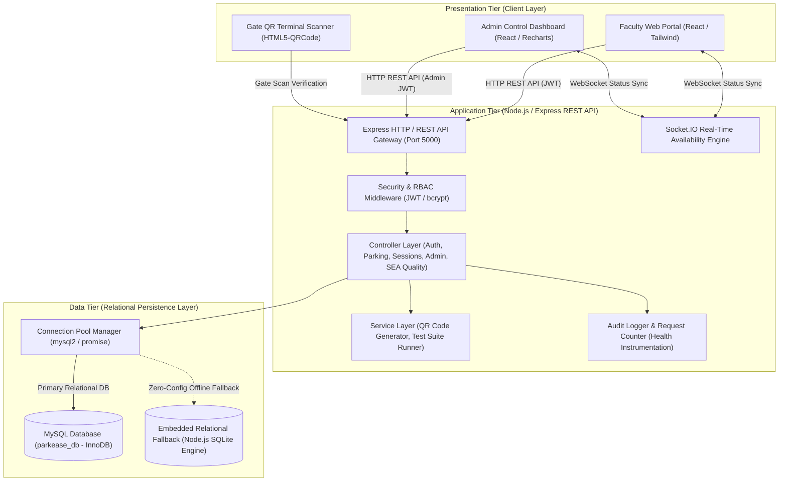
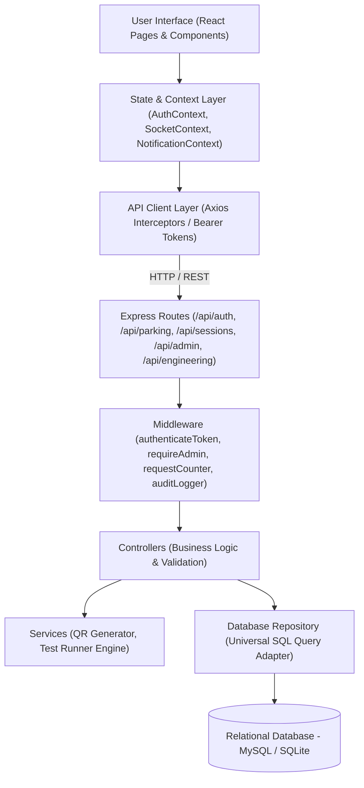
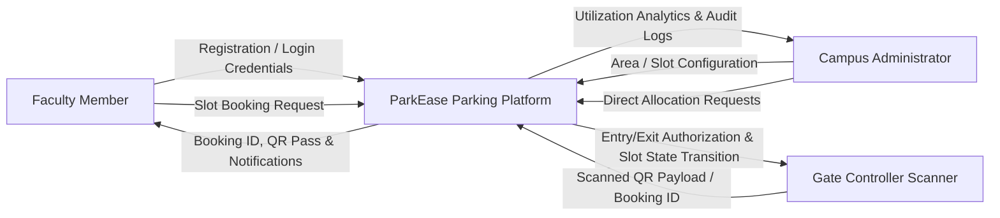
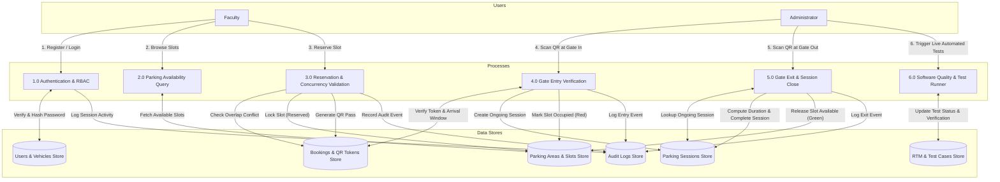

# ParkEase – System Architecture & Data Flow

This document details the high-level architecture, module decomposition, and data flow of **ParkEase – Smart Parking Management System**, developed for **Software Engineering and Architecture (SEA)**.

---

## 1. System Architecture Diagram

ParkEase is built on a 3-tier modular, service-oriented architecture:
1. **Presentation Tier (Frontend):** React.js single-page application styled with Tailwind CSS, Lucide icons, and Recharts visualization.
2. **Application Tier (Backend):** Node.js Express.js RESTful API gateway integrated with a WebSocket (Socket.IO) push notification service.
3. **Data Tier (Persistence):** Relational MySQL database engine (InnoDB) with foreign key constraints, indexing, transactions, and embedded SQLite fallback.

---

## 2. Layered Architecture Breakdown

---

## 3. Data Flow Diagram (DFD)

### Level 0: Context Diagram

### Level 1: Functional Data Flow Diagram

