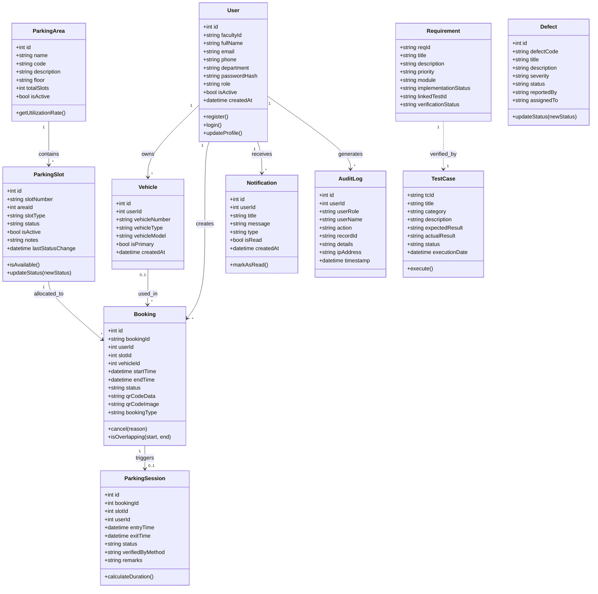

# ParkEase – Class Diagram

This document illustrates the object-oriented design and domain class relationships of the **ParkEase – Smart Parking Management System**.

## Mermaid Class Diagram

---

## Class Responsibility & Collaboration
- **`User`**: Base entity representing registered faculty members and administrators with secure JWT credentials and role attributes.
- **`Vehicle`**: Represents faculty 4-wheelers, 2-wheelers, and EVs associated with campus parking authorizations.
- **`ParkingArea`**: Represents campus zones (e.g. Main Academic Block, Tech Annex, Executive Wing) with floor information.
- **`ParkingSlot`**: Encapsulates slot state transitions: `available` (Green), `occupied` (Red), `reserved` (Blue), and `unavailable` (Grey).
- **`Booking`**: Maintains reservation time windows, atomic overlap collision algorithms, and generated QR code payloads.
- **`ParkingSession`**: Represents active vehicles parked inside the campus gate from entry timestamp to exit timestamp.
- **`Requirement` & `TestCase`**: Powers the **Software Engineering Traceability Matrix (RTM)** linking REQ-01 through REQ-32 directly with automated verification test cases TC-01 to TC-20.

