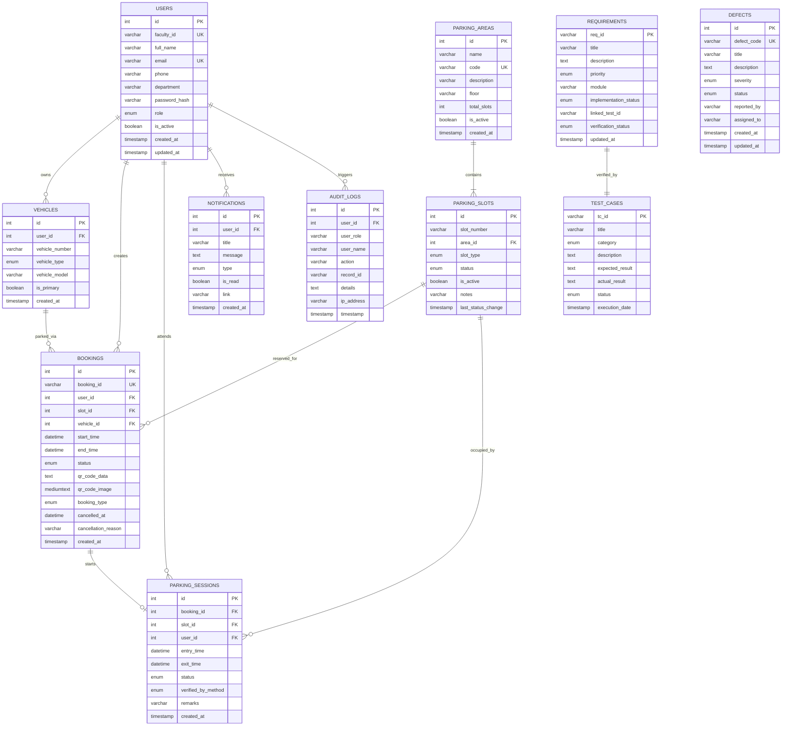

# ParkEase – Entity-Relationship (ER) Diagram

This document contains the Entity-Relationship (ER) diagram for the **ParkEase – Smart Parking Management System** normalized relational database (`parkease_db`).

## Mermaid ER Diagram

---

## Relational Constraints & Integrity
1. **Uniqueness:**
   - `users.faculty_id` and `users.email` are strictly unique.
   - `parking_slots (area_id, slot_number)` has a composite unique constraint preventing identical slot numbers within the same campus parking area.
   - `bookings.booking_id` is unique across all reservations.
2. **Referential Integrity:**
   - `vehicles.user_id` cascades on user deletion.
   - `parking_slots.area_id` uses `RESTRICT` to prevent accidental deletion of areas containing active bays.
   - `bookings.slot_id` uses `RESTRICT` to prevent deleting slots with active reservations.
   - `parking_sessions.booking_id` has a 1-to-1 relationship with unique foreign key constraint.
3. **Audit Trail:**
   - `audit_logs.user_id` sets to `NULL` on user deletion to preserve the forensic audit record integrity.

