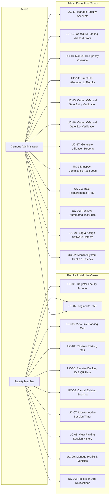

# ParkEase – Use Case Diagram

This document describes the primary use cases and actor boundaries for the **ParkEase – Smart Parking Management System**.

## 1. Actors
- **Faculty Member:** Registered teaching, research, or department staff accessing the web application to view parking availability, reserve slots, view QR passes, monitor active parking sessions, review history, and manage profile/vehicles.
- **Administrator:** Campus administrative personnel and gate operators responsible for slot allocation, occupancy override, parking area/slot inventory management, faculty account activation, gate entry/exit verification, reports generation, and software quality monitoring.

---

## 2. Mermaid Use Case Diagram

---

## 3. Key Use Case Descriptions

### UC-04: Reserve Parking Slot
- **Primary Actor:** Faculty Member
- **Precondition:** Faculty is authenticated with a valid JWT token; slot status is `available`.
- **Main Flow:**
  1. Faculty browses campus areas and selects an available green slot.
  2. Faculty specifies parking date, start time, end time, and registered vehicle.
  3. System initiates atomic concurrency check to ensure no overlapping confirmed/active bookings exist.
  4. System creates booking record with unique ID (`PE-YYYYMMDD-XXXX`).
  5. System generates base64 QR code encoding booking metadata.
  6. Slot status transitions to `reserved` (Blue) and real-time socket event is broadcasted.
  7. In-app confirmation notification is dispatched to faculty.

### UC-15: Gate Entry Verification
- **Primary Actor:** Administrator / Gate Controller
- **Precondition:** Faculty vehicle arrives at campus gate with digital QR pass.
- **Main Flow:**
  1. Gate operator points camera at QR code or inputs the Booking ID manually.
  2. Backend decodes payload and queries booking record.
  3. System validates booking is confirmed, slot matches, and current time is within permitted arrival window.
  4. System logs vehicle entry timestamp and creates ongoing `parking_sessions` record.
  5. Slot status transitions to `occupied` (Red).
  6. Audit activity is logged, and entry confirmation notification is sent to faculty.

### UC-16: Gate Exit Verification
- **Primary Actor:** Administrator / Gate Controller
- **Precondition:** Vehicle is currently parked with an active session.
- **Main Flow:**
  1. QR code is scanned or session ID is verified at gate exit.
  2. System records departure timestamp and calculates duration (hours/minutes).
  3. Parking session is updated to `completed`.
  4. Slot status transitions back to `available` (Green).
  5. Real-time availability updates on all dashboards instantly.

